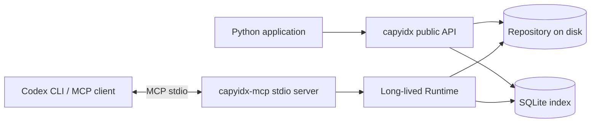
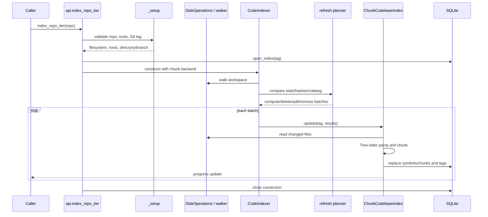
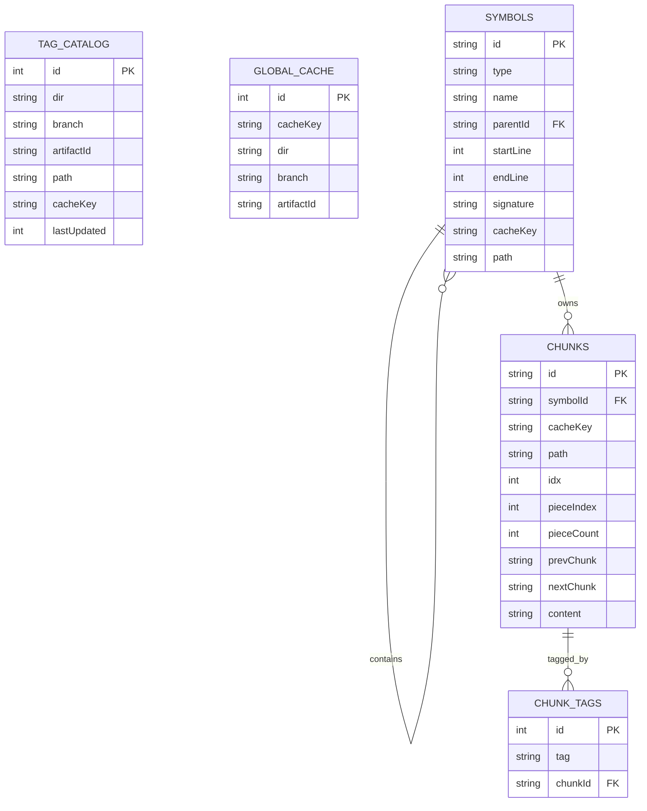
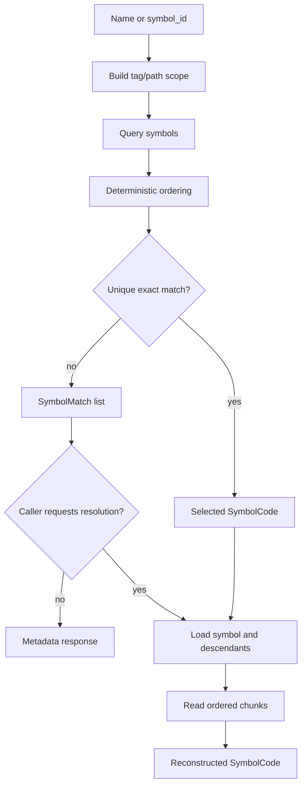
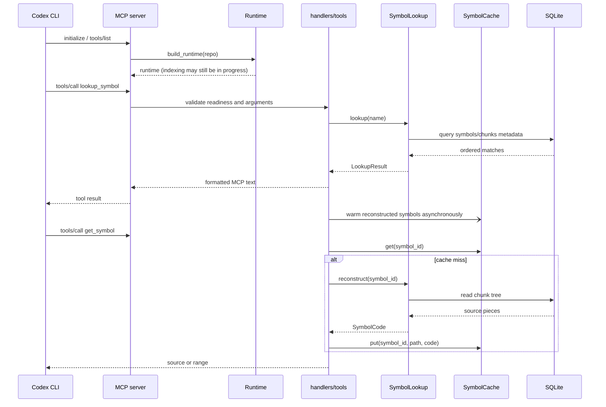

# CapyIdx architecture

CapyIdx is an asynchronous, repository-aware source indexer. Its production
path currently indexes source files into a per-repository SQLite database and
offers deterministic symbol lookup and source reconstruction. The package also
contains extension points for full-text search, code snippets, embeddings, and
LanceDB, but those backends are not wired into the public `index_repo` flow in
version 0.1.4.

## System context

CapyIdx can be embedded directly through the Python API or run as an MCP stdio
server for Codex CLI. Both entry points use the same indexing and retrieval
components.

## Package structure

| Area | Responsibility | Runtime status |
| --- | --- | --- |
| `api.py` | Async public indexing and lookup façade | Active |
| `indexer/` | Refresh orchestration, batching, readiness, watching, branch changes | Active |
| `walker/` and `utils/disk_operations.py` | Directory traversal and file access | Active |
| `base/refresh_index.py` | Hash comparison and persisted catalog operations | Active |
| `chunker/` | Tree-sitter parsing, symbol extraction, chunk splitting | Active |
| `db/` | SQLite path selection, schema, connection lifecycle | Active |
| `retrieval/` | Name matching, scope filtering, and chunk-tree reconstruction | Active |
| `watcher/` | Watchdog watcher with polling fallback | Active when watch mode is enabled |
| `mcp/` | MCP lifecycle, tools, response formatting, cache warming | Active |
| `fts/` | Full-text-search index backend | Lower-level / not public-API wired |
| `embeddings/` and `lance_db/` | Embedding providers and vector index | Lower-level / optional |
| `codesnippet/` | Code-snippet index backend | Lower-level / not public-API wired |

## Indexing pipeline

`index_repo_iter()` is the primary indexing path. `index_repo()` is a thin
consumer that waits for the iterator to finish and discards progress events.

1. `_setup()` validates the repository, creates `DiskOperations`, resolves
   workspace directories, and derives the current Git directory/branch tag.
2. `open_index()` opens the deterministic SQLite database, enables WAL and
   foreign keys, initializes the schema, and writes metadata once.
3. `CodeIndexer.refresh_codebase_index()` walks the workspace and compares
   current file statistics and content hashes against `tag_catalog`.
4. The refresh planner emits four operation classes: `compute`, `delete`,
   `add_tag`, and `remove_tag`. Operations are processed in batches.
5. `ChunkCodebaseIndex` reads changed files, skips unsupported/oversized content,
   parses supported languages with Tree-sitter, extracts symbols, splits source
   into token-bounded chunks, and writes rows to SQLite.
6. Progress updates are yielded throughout. The connection is closed by the
   API wrapper even when indexing fails or is cancelled.

### Incremental refresh semantics

The persisted catalog is keyed by directory, branch, artifact, path, and a
content hash (`cacheKey`). A changed file is re-read and hashed only when its
filesystem timestamp indicates it may have changed. The chunk backend removes
the file's prior symbols/chunks before inserting the replacement tree. SQLite
foreign-key cascades remove associated `chunk_tags` rows.

Deleted paths produce delete operations. Branch changes are detected by polling
`.git/HEAD`; the indexer stops the file watcher, clears pending work and the
symbol cache, refreshes the complete workspace, then restarts watching.

## Storage model

The default database location is derived from `CAPYIDX_HOME` or the user's home
directory, under `.capyIdx/.codebase_index` in the current implementation. The
database filename is a SHA-256-derived value for the `(directory, branch)` pair.

`symbols` forms a hierarchy such as file → class → method. File symbols are
structural roots and normally have no chunk of their own. `chunks` stores the
reconstructable source pieces, including line ranges, signatures, and links
between pieces. Tags scope rows to a directory/branch/artifact identity.

## Retrieval pipeline

`SymbolLookup` performs deterministic matching in this order: case-sensitive
exact name, case-insensitive exact name, then case-insensitive substring. It
sorts matches by path and source range, optionally scopes by path/tag, and can
reconstruct one symbol or all descendants from the chunk tree.

The public query methods intentionally support two-phase access:

* `lookup_symbol()` returns metadata and only selects code for a unique exact
  match.
* `reconstruct_symbol()` materializes one known `symbol_id`.
* `resolve_lookup()` materializes every match in match order.
* `open_lookup()` keeps one SQLite connection open for repeated synchronous
  lookup calls inside an async context manager.

## Watch mode and consistency

`AutoFileWatcher` selects `watchdog` when available and otherwise uses polling.
Both implementations yield batches of changed file URIs. `CodeIndexer` puts
these paths in a pending set, invalidates cached symbols for each path, waits
for the configured flush interval, and refreshes the batch. Paths currently
being refreshed are exposed as pending/in-flight state.

The MCP handlers reject lookup/materialization while the initial index or a
branch reindex is running. On a cache miss, handlers also wait for the symbol's
path to leave the pending/in-flight sets. This prevents returning source that
may be stale during an incremental refresh.

## MCP server architecture

The `capyidx-mcp` console script starts a stdio MCP server. Its lifespan creates
one `Runtime` containing the SQLite connection, `CodeIndexer`, `SymbolLookup`,
file-watch task, branch-watch tasks, and initial-index task.

The exposed tools are:

| Tool | Purpose |
| --- | --- |
| `lookup_symbol` | Return candidate IDs, paths, ranges, and signatures |
| `get_symbol` | Return full or truncated symbol source by ID |
| `get_symbol_range` | Return an absolute line range within a symbol |

Lookup results trigger best-effort background cache warming. The bounded symbol
cache is invalidated by changed paths and drained before shutdown; shutdown
cancels indexing/watch tasks before closing SQLite.

## Optional and future backends

The `CodebaseIndexer` protocol allows multiple artifact backends to consume the
same refresh operation lists. The repository includes implementations or
scaffolding for FTS, code snippets, embeddings, and LanceDB. They should be
treated as extension points until a caller explicitly constructs them and
passes them to `CodeIndexer`; the public API currently constructs only
`ChunkCodebaseIndex`.

## Operational boundaries and risks

* Indexing requires a repository for which current directory/branch tags can be
  determined; `_setup()` raises when tags cannot be resolved.
* SQLite connections are deliberately shared by the long-lived MCP runtime;
  task shutdown order matters because cache warming and watchers can query the
  connection.
* The watcher ignores hidden files and ignore-file patterns. Editing
  `.gitignore` does not update watcher rules until the watcher is restarted.
* Responses can be truncated by the MCP character limit; callers should use
  `get_symbol_range` for follow-up retrieval.
* The package metadata version in `pyproject.toml` and the runtime versions in
  `capyidx.__version__`/the MCP server should be kept synchronized when making
  releases.

## Verification map

The test suite covers the public API contract, package exports, API smoke and
regression behavior, MCP tools/handlers/formatting/cache, and runtime shutdown
and notification behavior. Recommended checks are the same as the project
README: `compileall`, `pytest`, and `python -m build`.

