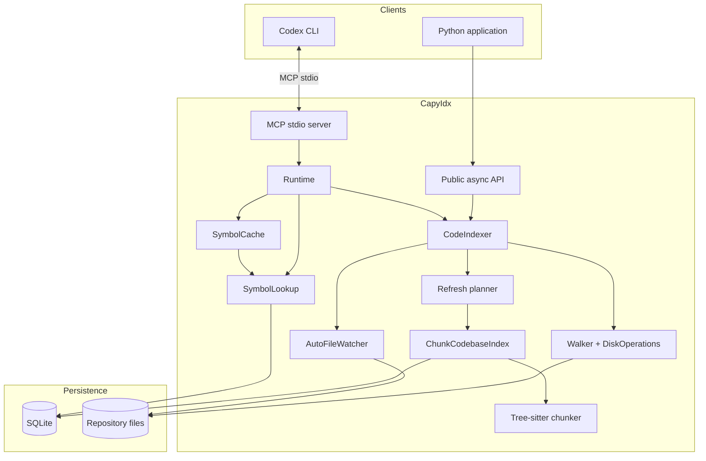
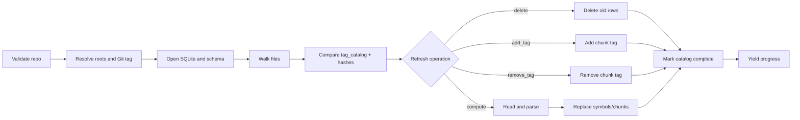
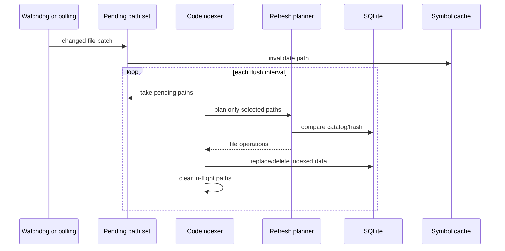
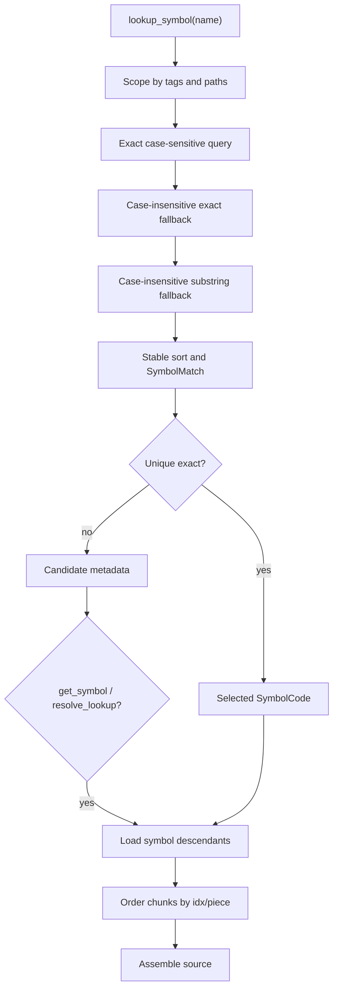
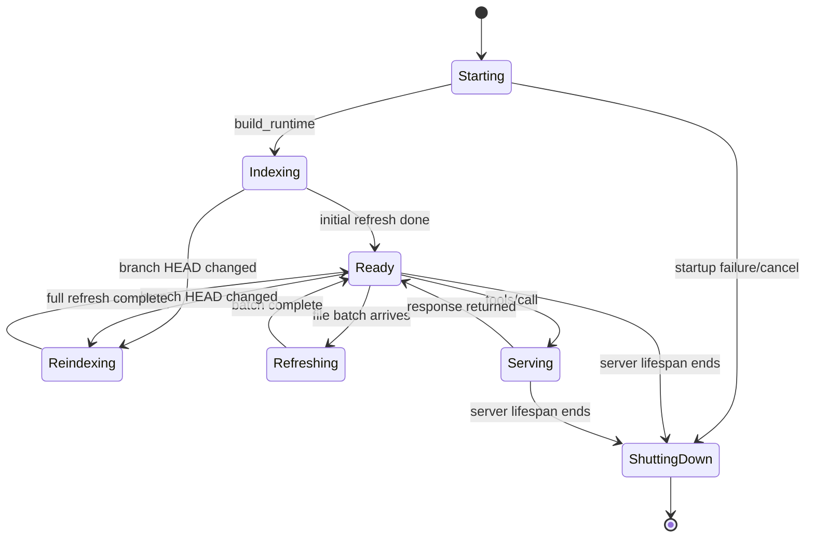

# CapyIdx diagrams

These diagrams are kept separately for design reviews and documentation sites
that want to embed only the visuals. They use Mermaid and render in GitHub,
GitLab, and Mermaid-compatible Markdown viewers.

## Component view

## Initial indexing

## Incremental watch refresh

## Symbol lookup and reconstruction

## MCP request lifecycle

